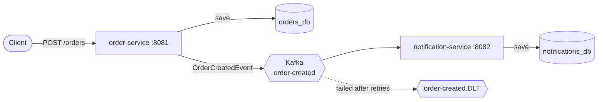
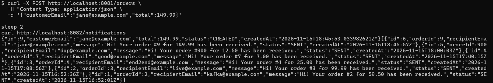
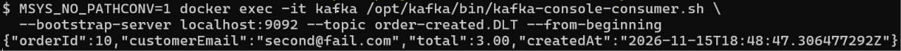

<div align="center">

# 📦 Order Notification System

### Event-driven microservices with Spring Boot, Apache Kafka, MySQL & Docker


[](https://github.com/hemachandran-4/order-notification-system/actions)

*Place an order → an event flies through Kafka → a notification is delivered.*
*Two independent services. Zero direct coupling.*

</div>

---

## ✨ Features

- 🛒 **Order Service**: REST API to create and fetch orders, persisted in MySQL
- 📨 **Event publishing**: emits an `OrderCreatedEvent` to Kafka on every new order
- 🔔 **Notification Service**: consumes events, "sends" the notification, stores the result
- 🔁 **Resilience**: 3 retries with exponential backoff (1s, 2s, 4s), then a Dead Letter Topic
- 🧱 **Idempotent consumer**: duplicate events never create duplicate notifications
- 🗄️ **Database per service**, versioned with Flyway migrations
- 🐳 **One-command startup** with Docker Compose
- ✅ **Integration tests** with Testcontainers and **CI** via GitHub Actions

## 🏗️ Architecture



## 🧰 Tech Stack

| Layer | Technology |
|-------|-----------|
| Language | Java 17 |
| Framework | Spring Boot 4.1 (Web, Data JPA, Validation, Actuator) |
| Messaging | Apache Kafka (KRaft mode, no Zookeeper) |
| Database | MySQL 8.4 + Flyway |
| Containers | Docker, Docker Compose |
| Testing | JUnit 5, Testcontainers |
| CI | GitHub Actions |

## 🚀 Quick Start

**Prerequisite:** Docker with Compose. Nothing else.

```bash
git clone https://github.com/hemachandran-4/order-notification-system.git
cd order-notification-system
docker compose up --build -d
```

The first build takes a few minutes. Give the services about 20 seconds to start, then check:

```bash
curl http://localhost:8081/actuator/health
curl http://localhost:8082/actuator/health
```

## 🧪 Try It

**1. Create an order**
```bash
curl -X POST http://localhost:8081/orders \
  -H "Content-Type: application/json" \
  -d '{"customerEmail":"jane@example.com","total":149.99}'
```

**2. See the notification created asynchronously**
```bash
curl http://localhost:8082/notifications
```



**3. Trigger a failure.** Any email ending in `@fail.com` simulates an SMTP error:
```bash
curl -X POST http://localhost:8081/orders \
  -H "Content-Type: application/json" \
  -d '{"customerEmail":"test@fail.com","total":5.00}'
```
The consumer retries 4 times in about 7 seconds, then parks the message in `order-created.DLT`:

```bash
docker exec -it kafka /opt/kafka/bin/kafka-console-consumer.sh \
  --bootstrap-server localhost:9092 --topic order-created.DLT --from-beginning
```



## 📡 API Reference

| Service | Method | Endpoint | Description |
|---------|--------|----------|-------------|
| order-service | `POST` | `/orders` | Create an order and publish an event |
| order-service | `GET` | `/orders/{id}` | Get an order by ID |
| notification-service | `GET` | `/notifications` | List notifications (optional `?orderId=`) |
| notification-service | `GET` | `/notifications/{id}` | Get one notification |
| both | `GET` | `/actuator/health` | Health check |

## 📁 Project Structure

```
order-notification-system/
├── .github/workflows/ci.yml
├── docker-compose.yml
├── init.sql
├── docs/
├── order-service/
│   ├── Dockerfile
│   └── src/main/java/.../{controller,service,repository,model,dto,event,config,exception}
└── notification-service/
    ├── Dockerfile
    └── src/main/java/.../{listener,service,repository,model,dto,event,config,exception}
```

## 🧠 Design Decisions

- **Database per service**: the services share nothing but events, so each can evolve and scale independently.
- **Each service owns its own event class**: no shared library, so there is no compile-time coupling. The producer sends no type headers.
- **Order ID as message key**: events for the same order go to the same partition, which preserves ordering.
- **Retries, then a Dead Letter Topic**: a poison message never blocks the ones behind it, and failures stay inspectable with exception headers.
- **Idempotent consumer in two layers**: an `existsByOrderId` check for the common case, plus a unique constraint on `order_id` as the final guard against races. Kafka delivers at-least-once, so duplicates are expected.
- **Flyway owns the schema**: Hibernate only validates (`ddl-auto: validate`).
- **Kafka KRaft mode**: fewer moving parts than Zookeeper.

## ⚠️ Known Limitations

- The order is saved and the event published in the same method, so a failure between the two can leave them out of sync (the dual-write problem). A transactional outbox would fix this, and it is on the roadmap.
- Email delivery is simulated with a log line.

## ✅ Running Tests

```bash
cd order-service && ./mvnw verify
cd ../notification-service && ./mvnw verify
```

Tests start real MySQL and Kafka containers with Testcontainers, so Docker must be running. Your compose stack does not need to be.

## 🗺️ Roadmap

- [x] Order and notification services
- [x] Retries and Dead Letter Topic
- [x] Idempotent consumer
- [x] Testcontainers and CI
- [ ] Transactional outbox pattern
- [ ] OpenAPI / Swagger UI
- [ ] Real email delivery (SMTP / SendGrid)

## 👤 Author

**Hemachandran** · [LinkedIn](https://linkedin.com/in/hemachandran-j4848/) · [GitHub](https://github.com/hemachandran-4)

⭐ If you found this useful, consider starring the repo!